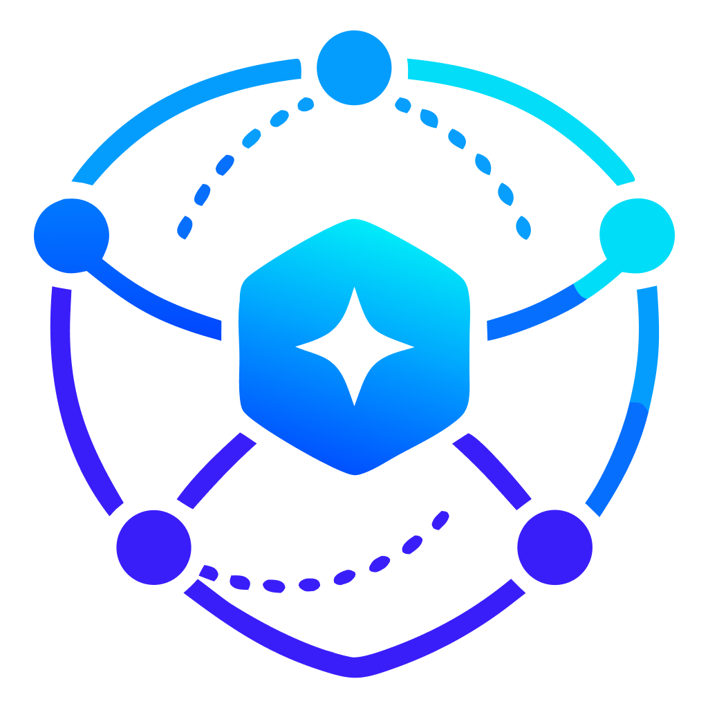

<p align="center">
  
</p>

# Guild

A Guild Stack plugin for AI coding hosts that gives you self-evolving teams of specialist agents.

Start with `/guild:guild "<task>"` in Claude Code. Guild proposes a workflow, composes a specialist
team, plans the work, assembles context, dispatches lanes, reviews, verifies,
and reflects. Project knowledge and run evidence stay under your active
root's `.guild/`; Guild never commits them for you.

## What v3.2.0 ships

This overview describes stable **v3.2.0** at
`2e58b0360ca51ca3c96ca8e015ef5aba5738803d`. The `next` baseline is
**3.3.0-beta.1** at `56e447fd285a6b36df88830e2383c1253399b991`; its metadata,
host receipts, documentation automation, and retired authoring checks do not
constitute a new stable release or fresh host verification.

- **15 specialist templates + 4 machinery agents** — 15 domain type templates
  across three groups (engineering: architect, researcher, backend, frontend,
  devops, qa, mobile, security; content & communication: copywriter, doc-writer,
  technical-writer, social-media, seo; commercial: marketing, sales), one
  `templates/specialists/*.md` per role, minted on demand into your project's
  `.guild/agents/` by team composition — plus the 4 machinery agents the plugin
  registers directly (advisor, context-manager, developer, team-lead; one
  `agents/*.md` each).
- **76 logical skills**, with 17 assemblers indexed by the Claude manifest —
  the indexed entries are (using-guild, init, brainstorm, plan, team-compose,
  execute-plan, quality, operations, learn, wiki, initiative, review, diagnose,
  evolve, create-skill, create-specialist, reflect). Everything else still ships
  but stays off the index: L3 chapters live in their parent assembler's
  `references/`, the 58 specialist starter recipes live under
  `skills/specialists/`, and the dashboard launcher lives under
  `skills/playbooks/dashboard/`.
- **13 command entrypoints** — `/guild:guild [brief]`, the six phase verbs
  `init`, `ideate`, `plan`, `build`, `qa`, `ops`, and `learn`, `wiki`,
  `initiative`, `status`, `config`, `maintain`. Sub-verbs are positional
  arguments. The old standalone verbs (`adopt`, `audit`, `dashboard`, `evolve`,
  `fix`, `goal`, `migrate`, `models`, `resume`, `rollback`, `stats`) are
  sub-verbs of `init`, `maintain`, `status`, `plan`, and `config`; their
  alias files are removed. See [Commands](#commands).
  Claude Code keeps the `/guild:` namespace.
- **One runtime shape** — `/guild:guild` is the T0 orchestrator session: with no
  verb it runs intake and binds one of five class graphs (product · research ·
  debug · ops · init); `research`, `debug`, and `--class=` bind the class
  directly. Work runs in three tiers (T0 → a Team Lead per TaskCell →
  specialists) that report only through `guild.goal_status.v1` and
  `guild.handoff.v2`. Each cell runs one inner loop (recall → research-on-miss →
  implement → verify → harvest) under an enforced budget (`advisorRounds`,
  optional token/usd caps). The critic is the advisor machinery agent; product
  `qa` is the one review gate.
- **Two context sizes** — a specialist's on-disk bundle is at most 6k tokens; a
  parent sees only the lane bundle of at most 1,200 tokens of citations, of which
  matching `.guild/wiki/glossary.md` terms take at most 200. The full glossary is
  never always-on.
- **One promotion law** — harvest promotes decision-shaped verdicts to this
  cwd's wiki and span-replaces project playbooks through `scrubbedWrite`, and
  never commits. `wiki.autopromote` defaults on; `false` makes the root
  candidates-only. Specialists never write the wiki. The per-phase checkpoint is
  a domain function that only classifies. Wiki `labels.concern` uses the shipped
  enum: architecture · security · performance · reliability · data · api · ux ·
  build · ops.
- **Host adapters with bounded evidence** — the stable registry lists 16 targets;
  this is not a count of fully verified installations. At the stable pin, the matrix
  has seven receipt-promoted CLI rows: Claude Code is `native`; Codex, Pi,
  Antigravity, Cursor, opencode, and Rovo Dev are `verified_wrapped`.
  Wrapper receipts do not establish native install activation or full lifecycle
  conformance. GitHub Copilot and the AGENTS-file/Kiro/Qoder/Trae targets retain
  `unsupported` Public State. Claude Code app/web, Codex app, and Claude.ai
  connector rows also retain `unsupported`, with manual or enqueue-only paths;
  app labels do not inherit CLI proof. See the
  [stable generated matrix](https://github.com/lookatitude/guild/blob/2e58b0360ca51ca3c96ca8e015ef5aba5738803d/docs/generated/host-support-matrix.md)
  for each operation; beta receipt updates do not extend that stable evidence.
  The v3.2.0 signed [conformance record](.guild/artifacts/release/v3.2.0/conformance.json)
  names one tuple: Claude Code CLI **2.1.310**, **darwin-arm64**, release-source
  commit `7e26078b45f574e6ff20c9b217934a35d64becb1`. Its 31 evaluated scenarios
  include expected refusals, failures, and degradations. This README refresh
  inspected that record; it did not rerun the suite or reverify its signatures.
- **10 hook events wired** — `SessionStart`, `UserPromptSubmit`, `PreToolUse`,
  `PostToolUse`, `PreCompact`, `SubagentStop`, `Stop`, `TaskCreated`,
  `TaskCompleted`, `TeammateIdle`.
- **Operator tooling** — compiled Node CLIs cover evolution, rollback, run
  analysis, telemetry, validation, migration, capability adoption, and packaging.
  `scripts/` is the authoring source; installed execution uses
  `runtime/scripts/*.js`. Users do not need Bun; development tests use
  `bun test --isolate`.
- **2 optional MCP servers** — `guild-memory` (wiki search) and
  `guild-telemetry` (structured trace query), two ids of
  one compiled `runtime/guild-mcp.js` built from `src/runtime/mcp/`. Both
  stdio-only, no network. Guild runs without them.
- **Dispatch backends** — cmux panes, tmux panes, in-process Agent dispatch
  plans, and remote SSH dispatch, with a subagent fallback. With `agent_mode` set to
  `auto` or `team`, a cmux session selects cmux before tmux; explicit `agent` and
  `subagent` preferences retain precedence. cmux selection/preflight fixtures
  ship, but live end-to-end proof is still pending. Missing capabilities produce
  explicit degradations or refusals; not every fallback can safely continue.
- **Policy and model tiering** — cheap / mid / powerful tiers, advisor rounds,
  token/spend budgets, and a default concurrency limit of four workers (not a
  team-size cap). Durable writes accept the closed set of **15 policy keys**;
  host identity and concrete models bind per run. Legacy settings readers expose
  additional keys, which are not all writable through `config set`. Dynamic
  M2 model routing defaults off; a requested model is not proof of the served
  model. `/guild:config models inspect` verifies session/catalog sources, but its
  production path passes policy, resolution receipt, and adjudication as
  `null`: verified readers for those inputs are absent, so they remain unknown.
  Richer service fixtures do not establish production reader availability.
- **Recall** — `recall.backend: bm25 | hybrid` (default `bm25`). Embeddings are
  cache only; a missing embedding model fails open to BM25. The storage
  architecture classifies the SQLite index as an external, rebuildable cache
  (`index: "auto"`, default; disable with `index: "off"`). Retained
  `index-cache` compatibility helpers still derive `.guild/index.sqlite`;
  this source path is not evidence of a freshly observed cache write.
- **Learning and evolution** — cheap mapping, deeper structural/semantic
  graphs, onboarding, diff analysis, and artifact harvest. Plain init stays
  cheap; deep learning is opt-in. Reflection proposes improvements; shadow
  evaluation gates evolution. Span edits retain inverse history for rollback.
  Automatic curation is limited to project skills/playbooks; machinery changes
  become candidates for a human to commit. Upstream issue filing asks first.
- **Security and observability** — capability scopes, secret scrubbing and
  credential-bearing prose refusals, run traces, receipt reconciliation, cost
  rollup, and run comparison/recommendations. Missing observations remain
  degraded or unknown. Host permission modes do not waive Guild's hard gates.
  `/guild:status dashboard` launches the separate benchmark UI.

## Getting Started

### Install

The quickest path is the installer script (`install.sh` at this repo's root —
detects your AI coding hosts, selects the host's install path, never uses
`sudo`, never edits shell profiles):

```bash
curl -fsSL https://guildstack.dev/install.sh | bash
```

Domain unavailable? The same script ships in this repo:

```bash
curl -fsSL https://raw.githubusercontent.com/lookatitude/guild/main/install.sh | bash
```

Preview host-specific install paths without changing anything:

```bash
curl -fsSL https://guildstack.dev/install.sh | bash -s -- --dry-run --host claude-code-cli
curl -fsSL https://guildstack.dev/install.sh | bash -s -- --dry-run --host codex-cli
curl -fsSL https://guildstack.dev/install.sh | bash -s -- --dry-run --host pi-cli
curl -fsSL https://guildstack.dev/install.sh | bash -s -- --dry-run --host antigravity-cli
curl -fsSL https://guildstack.dev/install.sh | bash -s -- --dry-run --host agents-file
```

Installing manually into Claude Code does exactly the same thing:

```bash
claude plugin marketplace add lookatitude/guild
claude plugin marketplace update guild
claude plugin install guild@guild
```

### Release channels — stable vs beta

Branches are distribution channels: **`main` is stable** (released versions —
what the commands above install) and **`next` is beta** — merged work still
being tested ahead of the next release. To follow the beta channel:

```bash
# Claude Code — pin the marketplace to the next branch:
claude plugin marketplace add lookatitude/guild@next
# marketplace update keeps tracking the pinned next ref:
claude plugin marketplace update guild
claude plugin install guild@guild

# install.sh — beta selector for an installable target:
curl -fsSL https://guildstack.dev/install.sh | bash -s -- --channel beta
```

Switch back to stable by re-adding the marketplace without the `@next` pin (or
`--channel stable`). Beta may contain unreleased behavior; release notes only
cover what has reached `main`.

### Staying up to date

The installer records host, channel, ref, and commit in machine-level install
receipts. Update receipted installs with:

```bash
curl -fsSL https://guildstack.dev/install.sh | bash -s -- --update
```

Claude marketplace installs can use:

```bash
claude plugin marketplace update guild
claude plugin update guild@guild
```

Wrapper-package hosts can use `guild-run update` with their install receipt.
Codex owns its plugin cache; Guild does not swap it. Native installs without a
machine receipt receive host-specific update guidance. File-surface installs
need the refreshed instruction tree copied into the consuming project.
App/connector targets are not CLI package installations.

SessionStart reads cached update information; background refresh follows the
configured cadence. `defaults.update.mode` is a legacy settings option
(`notify`, `auto`, or `off`), not one of the 15 writable policy keys.

For local development, see [CONTRIBUTING.md](CONTRIBUTING.md). Develop against
the generated Claude package and restart the host after installation or package
changes. The examples here describe the released installer and command surface;
they were inspected, not executed by this documentation refresh.

### First run

In Claude Code, run `/guild:guild` with a brief, or with no arguments. With no
arguments, `/guild:guild` runs intake, classifies the work, and proposes the
next step for you to confirm:

```text
/guild:guild "Build a Stripe subscription flow, add tests, update the docs, draft a launch email."
/guild:guild
```

On Claude Code, restart after installation and look for the SessionStart
bootstrap card. Other hosts expose commands and bootstrap through their own
adapters; the slash examples here use Claude Code's spelling.

For a small example, ask `/guild:guild "Explain this repository and propose one small
improvement."` Guild proposes a class and phase, then asks at the applicable
gates. `--auto-approve[=spec,plan,build,qa,all]`, or the resolved `auto_approve`
setting in `.guild/settings.json`, can approve eligible soft gates, including
build. `auto_approve` is a legacy setting, not one of the 15 writable policy
keys. Team roster approval is always explicit; hard gates, such as destructive
actions, credentials, and QA BLOCK overrides, remain human-gated.
Approved work dispatches in lanes,
returns handoff evidence, and passes review/verification before closeout.
Initiatives are opt-in, so a one-off run need not create one.

Inspect the active run with `/guild:status`. Status may record a lightweight run
when `.guild/` exists; `record_status_runs: false` disables that legacy setting.
Use `/guild:maintain audit` for a static audit or `/guild:maintain fix <symptom>`
for diagnosis. Inspect the bound run's trace and receipt evidence; a visible
bootstrap card alone does not prove that every hook or dispatch operation ran.

The optional MCP entries are `guild-memory` (wiki search) and `guild-telemetry`
(trace queries/cost rollup). They select `wiki` and `trace` in the single bundled
`runtime/guild-mcp.js`, sourced from `src/runtime/mcp/`. Both use Node and stdio;
their declarations permit no network access. Filesystem/BM25 paths remain
available when MCP is absent, with host-specific limitations recorded.

## Commands

Claude Code exposes `/guild:guild` (the `commands/guild.md` entry) and
`/guild:<verb>` for the other entrypoints. The manifest registers exactly 13 command files and no retired
alias files. Other hosts render descriptors or instruction/prompt fallbacks;
they do not all expose native slash commands.

| Command | Purpose |
|---|---|
| `/guild:guild [brief] [research\|debug] [--class=…]` | T0 orchestrator session. No verb runs intake and proposes the class and phase for you to confirm; `research`, `debug`, and `--class=` bind the class |
| `/guild:init [--learn] \| adopt …` | Initialize Guild in a repo (wiki + brownfield cheap-scan map; `--learn` runs the full learn pipeline); `adopt` localizes shipped capability |
| `/guild:ideate` | Socratic spec — brainstorm the task into `.guild/spec/<slug>.md` |
| `/guild:plan \| goal …` | Compose the per-phase team + write per-specialist lane plans; `goal` emits `guild.goal.v1` goals from the spec |
| `/guild:build` | Assemble per-specialist context, dispatch the lanes, review handoffs |
| `/guild:qa` | The one review gate over the run |
| `/guild:ops` | Operations phase — release, monitoring, incident, rollback, maintenance runbooks |
| `/guild:learn [map\|graph\|knowledge\|onboard\|diff\|explain\|harvest]` | No sub-verb detects and confirms the full pipeline; sub-verbs scope mapping, graphs, knowledge, tours, change analysis, explanation, or harvest |
| `/guild:status [resume\|stats\|dashboard]` | Inspect run state (may record a lightweight status run); `resume` advances it, `stats` reads usage, `dashboard` launches the benchmark UI |
| `/guild:wiki <ingest <path>\|query "..."\|lint>` | Project knowledge over `.guild/knowledge/sources/` and `.guild/wiki/` |
| `/guild:initiative <new\|status\|list\|resume\|update\|archive\|restore\|close>` | Durable multi-run work (opt-in; a one-off `/guild:guild` never creates one) |
| `/guild:config <init\|reconcile\|show\|set\|role\|ui\|validate\|providers\|update-mcp-hashes\|models\|migrate>` | Policy config; `init` maps to `reconcile sync`; `models inspect` reads session evidence; `migrate` handles layout conversion |
| `/guild:maintain <evolve\|rollback\|audit\|fix\|gc\|wiki revert\|analyze>` | Evolution, rollback, audit/diagnosis, wiki reversal, and run analysis; `gc` currently reports no chapter and stops |

The `/guild:guild` entry also accepts `--rigor=quick|standard|deep`,
`--auto-approve[=spec,plan,build,qa,all]`, and `--review=local|cross|off`.

Retired spellings move under these entries: `adopt` → `init adopt`;
`goal` → `plan goal`; `models` / `migrate` → `config models` /
`config migrate`; `resume` / `stats` / `dashboard` → `status …`;
`evolve` / `rollback` / `audit` / `fix` → `maintain …`.
These are replacement spellings, not compatibility command files.

Illustrative Claude Code inputs (replace `<run-id>` with an existing run):

```text
/guild:init
/guild:init --learn
/guild:config models inspect --json
/guild:config migrate --mode=dry-run
/guild:wiki query "architecture"
/guild:maintain analyze inspect run <run-id>
```

Migration accepts `--mode=migrate|dry-run|skip|verify` (default `dry-run`).
`--recheck` is a flag for `--mode=migrate`; `--accept-grades` is the
wiki-only grade action. Review the dry-run before choosing a write mode.

## Documentation

The workspace [source-pinned reference guides](https://github.com/lookatitude/guild-workspace/blob/next/docs/reference/guides/index.html)
supplement the authoritative generated capability projection in
`docs/reference/`. For contributor ownership and the single plugin-to-site
cycle, follow the [maintainer guide](https://github.com/lookatitude/guild-workspace/blob/next/docs/maintainer-guide.md).
Feature, fix, and documentation PRs target `next` for testing before a stable
release.

Public guides live at **https://guildstack.dev/docs/**. These are navigation
routes; published prose may lag the pinned release and is not support evidence.

- [Architecture](https://guildstack.dev/docs/architecture) — implementation and host boundaries.
- [Teams and specialists](https://guildstack.dev/docs/teams-and-specialists/) — roster, team composition, dispatch, and context.
- [Knowledge](https://guildstack.dev/docs/knowledge/) — mapping, recall, and the wiki.
- [Skills](https://guildstack.dev/docs/skills/) — assemblers, chapters, and evolution.

## Architecture at a glance

The implementation has 12 domains, with public APIs in
`src/domains/<id>/index.ts`; adapters and the MCP runtime are projections.
Commands, skills, agents, templates, hooks, and scripts are authored once at the
root. `src/surfaces/` holds class graphs and prompt dialects. Host packages are
generated from that live surface; there is no resource-mirror sync step. Typed
lifecycle records and bound HTML projections carry evidence without making an
unbound document authoritative.

Four layers: the orchestrator session, the installed plugin (skills, machinery
agents, specialist templates, commands, hooks, scripts, MCPs), the composed
specialist team in scoped work lanes, and project-local state under `.guild/`
(including the minted specialist instances).

Diagrams and the full walkthroughs — lifecycle, skill taxonomy, project memory,
context assembly, team composition, self-evolution, and specialist creation —
live on the docs site: **https://guildstack.dev/docs**.

## Runtime state

All project-created Guild state lives under the active root's `.guild/` (never
committed by Guild itself):

```text
.guild/
├── guild.yaml            # root identity: workspace or project
├── config/project.json   # durable policy only; host and models bind per session
├── settings.json         # reconcile-owned settings surface (/guild:config)
├── agents/               # project-created specialists (files = source of truth)
├── skills/               # project-created skills
├── workflows/            # derived index; the five class graphs are the workflow runtime
├── loops/                # derived index; not authored truth
├── wiki/                 # synthesized knowledge, decisions, standards
├── knowledge/            # graph, indexes, sources/ (ingested blobs), candidates
├── memory/               # summaries, lessons, recall index
├── initiatives/          # initiative registry, active, archived
├── teams/                # reusable team definitions
├── artifacts/            # reports, audits, handoffs, generated outputs
├── indexes/              # codebase map + compatibility indexes
├── runs/                 # run traces, handoff receipts, review, verification
├── spec/                 # approved specs
├── plan/                 # per-task plans
├── team/                 # resolved specialist teams (<slug>.<phase>.yaml)
├── context/              # per-run specialist context bundles
├── reflections/          # proposed learnings and improvements
└── evolve/               # shadow-mode eval runs and reports
```

Project skill/playbook files are latest-only. Evolve replaces the selected span
and keeps compact inverse history on platform state; there is no
`skill-versions/` tree. The storage contract places rebuildable caches and
scratch outside durable state. Retained source paths include
`.guild/index.sqlite` in compatibility helpers and a cheap Init CodebaseMap
under `.guild/indexes/`; derived indexes must not be committed. Workspace
federation reads child project state in place instead of copying it.

## Principles

Every Guild specialist inherits the same operating prelude, folded into the
`using-guild` skill:

1. Think before doing.
2. Simplicity first.
3. Surgical changes.
4. Goal-driven execution.
5. Evidence over claims.

## License

MIT
